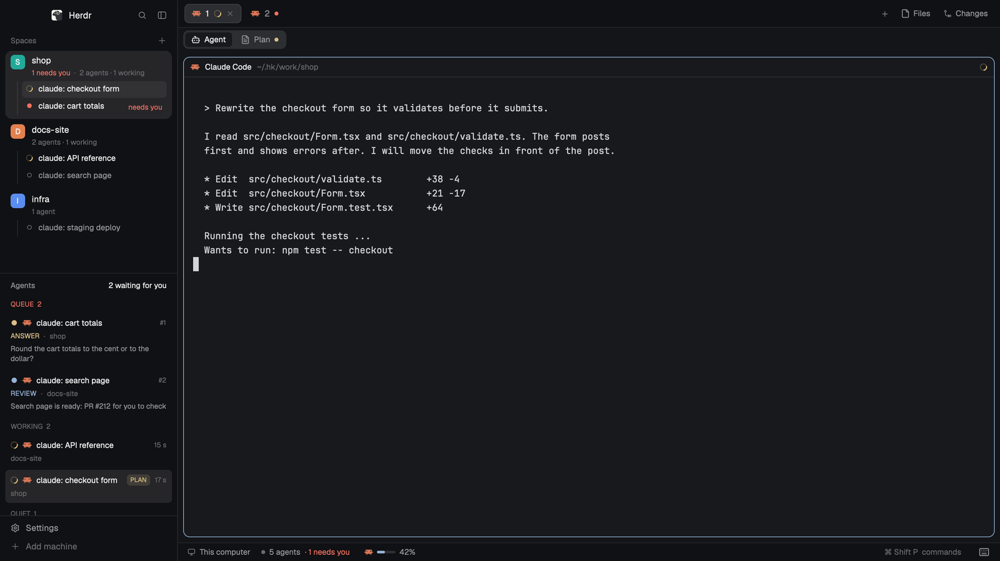

# herdr-kit

My [Herdr](https://herdr.dev) setup, as one command. Herdr shows agents in a flat sidebar: every space is one row, with its agents under it, and under that a queue of the agents that wait for you. It also adds a usage bar for Claude Code, an Agent / Plan / PRs bar under the tabs, a PRs view for the agent in the focused tab, a worktrees popup, a file viewer that agents open with `herdr-show`, and agent statuses that come from Claude Code hooks.



## Install

Open Herdr (the window must be open), then run this in a terminal:

```sh
npx herdr-kit
```

It checks your Herdr and your programs, lets you pick pieces, shows every change it will make, and asks once. Nothing is written before you say yes.

| Piece | What it adds | Needs |
|---|---|---|
| `core` | Flat sidebar (`spaces-flat`), sidebar groups, the agent queue, the usage bar, the `main-flat` layout | Herdr window open, Python 3 |
| `viewbar` | The Agent / Plan / PRs bar under the tabs, the hotkeys map | `core` |
| `prs` | The PRs view and the `herdr-prs` tool | Node 20+, `gh` logged in |
| `repo-worktree` | The worktrees popup (`cmd-shift-n`) | git |
| `file-viewer` | The viewer pane and the `herdr-show` tool | nothing |
| `statuses` | Claude Code hooks, the `herdr-status` tool, the status line | Claude Code (`jq` for the status line) |
| `plan` | Plans from [agent-plan-review](https://github.com/pavlo-petrychenko/agent-plan-review) inside Herdr | `agent-plan-review` installed |

A piece whose program is missing is switched off, with one line that says why. The PRs view shows in the bar of the `viewbar` piece. It knows which agent made which PR through the `statuses` piece.

The `plan` piece runs `agent-plan-review herdr enable` and `agent-plan-review herdr install`. Install agent-plan-review first (see its README).

### Without questions

```sh
npx herdr-kit --yes                          # every piece that can work
npx herdr-kit --yes --pieces core,viewbar    # only these pieces
```

### Flags

| Flag | Meaning |
|---|---|
| `--yes`, `-y` | No questions. Every piece that can work. A key that clashes with one of yours stays yours. A status line you already have stays. |
| `--pieces a,b` | Only these pieces. |
| `--home <dir>` | The Herdr home. Default: `$HERDR_APP_HOME`, else `~/.config/herdr-app`. |
| `--state-dir <dir>` | Where the kit keeps its tools and `manifest.json`. Default: `~/.local/share/herdr-kit`. |
| `--bin-dir <dir>` | Where the links to the tools go. Default: `~/.local/bin`. |
| `--claude-dir <dir>` | Claude Code's folder. Default: `$CLAUDE_CONFIG_DIR`, else `~/.claude`. |
| `--purge` | With `uninstall`: also delete the data the mods wrote. |
| `--help`, `-h` | Show the help. |

## What it changes

- **Herdr home** (`~/.config/herdr-app`):
  - `mods/` gets the mods of the pieces you picked: `space-groups`, `agent-queue`, `agent-usage`, `viewbar`, `prs`, `repo-worktree`, `file-viewer`.
  - `mods/spaces-flat/` and `layouts/main-flat.json` are **built from your own Herdr version**: the kit copies Herdr's `spaces` mod and `main` layout, then patches the copies. If Herdr's text changed so that the patch does not fit, the build stops, your layout stays as it is, the other pieces are installed, and the kit prints the Herdr version and the error so you can open an issue.
  - `space-groups.json` and `repo-worktree.json`: starter files, written only when you have none.
  - `mods/prs/config.json`: the path of `herdr-prs` (Herdr started from the Dock has a short `PATH`).
  - `keys.json`: these keys are added. A key that you already use for something else is not touched, unless you say so.
    - `global`: `cmd-shift-r` (flip Agent / Plan), `cmd-shift-g` (PRs view), `cmd-shift-n` (worktrees popup)
    - `layout:main-flat`: `cmd-w` (back to the agent)
    - `mod:plan-review`: `cmd-w` (back from the plan)
  - Then it shows the `main-flat` layout. `ctrl-shift-l` (`cmd-shift-l` on a Mac) switches back to your own.
- **`~/.local/share/herdr-kit/`**: the tools (`herdr-status`, `herdr-show`, `herdr-prs`), the Claude Code hook script and the status line script in a folder per version, `current` pointing at the newest, and `manifest.json`. They live here because the npx folder is temporary.
- **`~/.local/bin/`**: links to `herdr-status`, `herdr-show` and `herdr-prs`. If this folder is not on your `PATH`, the kit tells you what to add.
- **`~/.claude/settings.json`** (only with the `statuses` piece): these hooks are added, and your other hooks stay.
  - `SessionStart`, `SessionEnd`, `UserPromptSubmit`, `Stop`
  - `PreToolUse` for `AskUserQuestion` and for agent-plan-review's `plan_review_check`
  - `PostToolUse` and `PostToolUseFailure` for `plan_review_check`
  - The status line shows your plan's limits and feeds the usage bar. It is added only when you have none, or when you say you want yours replaced.
  - The `SessionStart` hook also tells the agent, inside Herdr only, to end each turn with `herdr-status <kind> "<one sentence>"`. Nothing is added to your `CLAUDE.md`.
  - Claude Code reads hooks when a session starts. Restart sessions that were already open.

Before the kit replaces a file (`keys.json`, `settings.json`), it copies it to `<file>.herdr-kit-<time>.bak`. It never overwrites a mod folder or a layout with the same name that it did not install: it stops and names it.

**A note on `keys.json`.** Herdr gives its new default shortcuts only to a `keys.json` that nobody edited. After the kit adds its keys, new Herdr shortcuts must be added by hand.

Some mods run programs (`git`, `gh`, `sqlite3`) and read files outside their folder (Claude Code's transcripts, for the PRs view). The usage bar asks OpenCode's server for your OpenCode Go limits when you use OpenCode Go. Each mod's header comment says what it does.

## Undo

```sh
npx herdr-kit uninstall
```

It removes the files the kit installed (listed in `manifest.json`), takes out its keys and hooks, puts back the backups, and shows your own layout again. A file that you changed after the install is kept and reported. The data the mods wrote (`data/agent-status`, `data/prs`, and so on) stays; add `--purge` to delete it too.

## After a Herdr update

Herdr's own `spaces` mod and `main` layout change between versions, and the flat sidebar is a copy. Build it again from the new version:

```sh
npx herdr-kit update
```

It also updates the mod files and the tools. Your files that you changed are kept.

## Check it

```sh
npx herdr-kit doctor
```

It checks Herdr and your programs, and that every installed file is still the one the kit put there.

---

## Develop

This part is for working on the kit itself. People who only want the setup can stop here.

My own machine does not use the npm package. The git checkout of this repo **is** the Herdr home (`~/.config/herdr-app`). `.gitignore` is an allowlist: Herdr's shipped mods, layouts, themes and runtime state are not tracked. The kit refuses to run when the home is a git checkout.

New machine:

```sh
cd ~/.config/herdr-app          # start Herdr once and quit it, so this folder exists
git init -b main
git remote add origin git@github.com:pavlo-petrychenko/herdr-config.git
git fetch origin
git checkout -f -B main origin/main
./install.sh
```

`install.sh` symlinks `extras/` into place (`~/.local/bin`, `~/.claude`, `~/.hrt`). It does not edit `~/.claude/settings.json`: the hooks and the status line are registered there by hand. After a Herdr update, run `./spaces-flat-sync.sh`.

### Tests

```sh
npm test
```

It runs the kit's tests (`kit/test/`, on temporary folders), the PRs tool, the hook, and each mod's tests.

### Try a pack on a clean Herdr

`kit/dev/fresh-window.sh` starts a second Herdr window with its own empty home, `~/.hk/app`. It never touches `~/.config/herdr-app`.

```sh
kit/dev/fresh-window.sh start
npm pack --pack-destination ~/.hk
mkdir -p ~/.hk/state ~/.hk/bin ~/.hk/claude
HERDR_APP_HOME=~/.hk/app npx --yes --package="$HOME/.hk/herdr-kit-<version>.tgz" herdr-kit \
  --home ~/.hk/app --state-dir ~/.hk/state --bin-dir ~/.hk/bin --claude-dir ~/.hk/claude
HERDR_APP_HOME=~/.hk/app herdr-app shot ~/.hk/shot.png
kit/dev/fresh-window.sh stop     # or: reset (also deletes ~/.hk)
```

Every `herdr-app` call for that window needs `HERDR_APP_HOME=~/.hk/app`.

### What is here

- `kit/`: the `herdr-kit` command (`cli.mjs`; `herdr.mjs`, `tools.mjs`, `claude.mjs` for the three kinds of change; `pieces.mjs` for the pieces; `keys.json` for the keys it adds; `defaults/` for the starter files).
- `mods/`: the mods: `repo-worktree`, `agent-queue`, `viewbar`, `agent-usage`, `file-viewer`, `prs`, `space-groups`, and `spaces-flat` (a copy of Herdr's `spaces`, patched; not in the package).
- `layouts/main-flat.json`: patched copy of Herdr's `main` layout (not in the package).
- `spaces-flat-patch.py`: makes `spaces-flat` and `main-flat` from Herdr's own files. The view bar, `main-stack` and the second view column are part of the patch. `spaces-flat-sync.sh` runs it on my machine.
- `extras/`: files that run from outside the Herdr home: `bin/herdr-show`, `bin/herdr-status`, `bin/herdr-prs`, `claude/hooks/herdr-status.mjs`, `claude/statusline-herdr.sh`, `hrt/start.sh` (a second window for testing mods).
- `extras/prs/`: `herdr-prs`, a Node command without dependencies. It finds an agent's pull requests (Claude Code transcripts and GitHub through `gh`) and writes `data/prs/<terminal>.json` for the PRs view. Data format: `extras/prs/FORMAT.md`.
- `keys.json`, `settings.json`, `repo-worktree.json`, `space-groups.json`: my own config. They are not in the package.
- `RECIPE.md`, `preview.png`: the listing at herdr.dev/layouts.

### The view bar and plans

`main-flat` has a bar under the tabs. `Agent | Plan` flips the main area (the stack `main-stack`) between the agent and the `plan-review` mod. That mod is not in this repo: it comes from agent-plan-review. Plans are found through its pointer files, `data/plan-review/<terminal>.json`. `cmd-shift-r` flips; `cmd-w` goes back to the agent while the plan shows. Panels for the second view are providers in `mods/viewbar/providers.js`. `mods/agent-queue/pointers.js` is a copy of `mods/viewbar/pointers.js` (a mod imports only its own files; a test checks that they match).

## License

MIT. See `LICENSE`.
