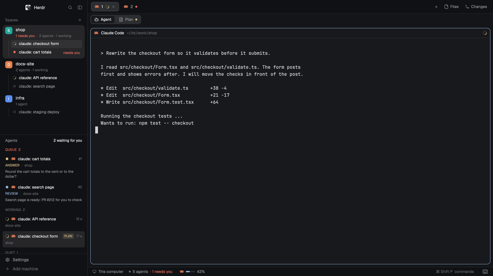

# Flat sidebar with an agent queue

A Herdr layout for people who run many agents. The left side is one flat list of spaces with each space's agents under it, and under that a queue of the agents that wait for you. A thin bar under the tabs flips between the agent and its plan, and opens a PRs view beside the agent. The usage bar at the bottom shows how much of your Claude limit is used.



## What you see

Left to right: a sidebar, the work area, and an optional right column.

**Sidebar** (268 px wide), top to bottom:
- The brand row (46 px), Herdr's own.
- **Spaces** (half of the height). Every space is its own row: a worktree is a space too, not a nested child. A row has a 22 px rounded badge with the first letter of the name on a colour (default teal `#22a99a`; the colours are `#22a99a`, `#e3814f`, `#5b8def`, `#8b7cf6`, `#3fae6a`, `#d9649a`), the name in semibold, and one line under it in 11 px dim text: `1 needs you · 2 agents · 1 working`. The name wraps at `-` `_` `/` `.` and is cut with "…" only when it is very long. Under the badge a thin vertical line carries one row per agent: a status mark, the agent's title (wraps), and on the right `needs you` (red, semibold), `done`, or how long it has been in its state. No fill until hover; the selected space has a soft fill. Spaces can sit under group headers (26 px, 11 px dim text) from `space-groups.json`; spaces that match no group go to "Other".
- **Agent queue** (the other half): see below.
- The footer (69 px): Herdr's own Settings and Add machine.

**Work area**, top to bottom:
- The tab bar (42 px), Herdr's own.
- The **view bar** (36 px): a toggle `Agent | Plan` on the left. Each button shows only when it applies: Agent when the focused tab has an agent, Plan when that agent has a plan (with a small dot in the plan's colour: yellow waiting for review, green approved, red changes requested). On the right: one button for each extra view the agent has (PRs).
- The body: the agent's panes as Herdr draws them (cards with a header, 10 px radius). With Plan on, the plan fills the same area. To the right of it, 400 px, an optional **second view** (the PRs view). At the far right, Herdr's own Files / Changes column (368 px). The second view and Files/Changes share the right edge: the one opened last stays.
- The status bar (28 px): on the left the machine, the agent count (`5 agents · 1 needs you`), the focused agent's logo and a small meter with its percentage (`42%`); click it for a popup with the 5-hour and weekly limits. At the right end a 44 px keyboard button that opens the hotkeys map.

**Agent queue** has three sections: `QUEUE n` (agents that wait for you, next one first), `WORKING n`, `QUIET n`. A row: status mark, agent logo, the agent's title, `#n` in the queue or the time in its state, the kind in upper case with the space (`ANSWER · shop`), and one sentence of what it wants. A `PLAN` chip sits on the rows of agents that have a plan.

## How it behaves

Agent statuses, as Herdr reports them: `working` (spinner), `blocked`, `idle` (hollow circle), `done`.
- **Queue order:** by kind, then longest wait first: `approve`, `answer`, `blocked`, `review`, `done`.
- **Where an agent goes:** `blocked` with a permission message: queue, `approve`. `blocked` with a question: queue, `answer`. An agent that Herdr shows as `working` stays under WORKING, even when it said `approve`. An agent that said `waiting` (CI, a deploy, a job) is under WORKING. An agent that said `done` while idle is under QUIET. A plan that waits for your review: queue, `review`, above the rest.
- **What the agent said** comes from `<home>/data/agent-status/<terminal>.json` (`{ kind, text, at, source }`), written by `herdr-status <kind> "<sentence>"` and by Claude Code hooks (`SessionStart`, `SessionEnd`, `UserPromptSubmit`, `PreToolUse`, `PostToolUse`, `PostToolUseFailure`, `Stop`). A new prompt from you clears it.
- The queue keeps the Mac awake while any agent is under WORKING (a `waiting` agent only for 3 hours).
- The queue shows the agents of the shown space's group. Agents of other groups that wait for you are only counted.

Clicks and keys:
- Click a space: select it. Drag: reorder. Right-click: the group menu (move to a group, make a folder, rename, close, "More…" for Herdr's own menu).
- Click an agent row, in the sidebar or the queue: go to that agent. Click a `PLAN` chip: go to the agent and show its plan.
- `cmd-shift-r` flips Agent / Plan. `cmd-w` goes back to the agent while the plan shows. `cmd-shift-g` opens and closes the PRs view. `cmd-shift-n` opens the worktrees popup.
- `ctrl-shift-l` switches back to the other layout.

The plan is read from `<home>/data/plan-review/<terminal>.json` (`reviewId`, `projectKey`, `version`, `status`, `title`). The Plan button needs the `plan-review` mod; without it the bar shows only Agent.

## Built from

**Layout** `layouts/main-flat.json`: a copy of Herdr's `main` layout with these changes. Node ids matter: the mods look them up.
- `root` row: `sidebar` column (268 px: `brand` block `workspace-chrome`, `sidebar-lists` column holding `spaces` block `spaces-flat` and `queue` block `agent-queue` at weight 1 each, `sidebar-footer` block `workspace-chrome` with `{ footer: true }`), then the `work` column.
- `work` column: `tabs` block (`tabs`, 42 px), `viewbar` block (`viewbar` with `{ role: "bar" }`, 36 px), the `work-body` row, the `status` row (28 px).
- `work-body` row: `main-stack` stack (children `main`, the tab area as before, and `plan`, mod `plan-review`), `side` column (`hidden`, 400 px, min 300, max 900) with `side-stack` stack (children `side-view`, mod `viewbar` with `{ role: "side" }`, and `side-prs`, mod `prs`), then Herdr's `panel` column.
- `status` row: `usage` block (`agent-usage` with `{ role: "bar" }`) and `keys` block (`viewbar` with `{ role: "keys-button" }`, 44 px). Herdr's separate Agents list is gone.

**Mods** (each in `mods/<name>/`):
- `spaces-flat`: Herdr's shipped `spaces` mod, cloned (`mod.clone {name: "spaces", as: "spaces-flat"}`) and changed by exact text swaps (`spaces-flat-patch.py`). The swaps: no nesting, one row per agent under each space, no `repo · branch` text, no git checks (Herdr runs `git status` per space on every change, which is slow on a big repo), group headers, the airy look in `styles.js`, and each row's presses (select, drag, right-click) moved into one function. A new Herdr version changes the text, so the swaps are built again from the person's own copy.
- `space-groups`: the right-click menu popup (230 x 360), `groups.js` (rules from `space-groups.json`: `groups: [{ name, folders: ["~/work/**"] }]`; `~/x/**` is x and everything under it, `~/x/*` its direct subfolders; folders made in the menu come after, and a space moved there stays there).
- `agent-queue`: the queue (sidebar block, and a popup with `mod.open:agent-queue`: up/down, Enter or 1-9, Esc). `queue.js` sorts; `groups.js` and `pointers.js` are copies of the files in `space-groups` and `viewbar` (a mod imports only its own files).
- `agent-usage`: the status bar (`role: "bar"`) and its popup (`role: "panel"`, 360 x 372). Reads `<home>/data/agent-usage/claude.json` (`{ at, five_hour: { used_percentage, resets_at }, seven_day: { ... } }`, written by `statusline-herdr.sh` from Claude Code's status line). It shows OpenCode's limits when OpenCode is installed (reads its database with `sqlite3`).
- `viewbar`: roles `bar`, `side`, `keys-button`. Commands `viewbar.flip`, `viewbar.prs`, `viewbar.close`. Keeps the shown view in shared `plan-review.view` and `viewbar.side`. Panels for the second view are providers in `providers.js`.
- `prs`: the PRs view; runs `herdr-prs refresh <terminal>`, reads `<home>/data/prs/<terminal>.json`. `mods/prs/config.json` `{ "cli": "/abs/path/to/herdr-prs" }` is per machine (Herdr started from the Dock has a short PATH).
- `repo-worktree`: popup (600 x 620), reads `<home>/repo-worktree.json`.
- `file-viewer`: a read-only viewer pane for `herdr-show`.
- `plan-review`: not in this repo; it comes from agent-plan-review (`agent-plan-review herdr enable`, `agent-plan-review herdr install`).

**Shipped Herdr mods used as they are:** `workspace-chrome`, `tabs`, `pane`, `files`, `changes`.

**Herdr functions and commands:** `agents()`, `terminals()`, `spaces()`, `layout()`, `shared`/`setShared`, `watchFolder`, `readTextFile`, `exec`, `run("space.select")`, `run("space.move")`, `layout.select`, `layout.switch`, `mod.clone`, `layout.clone`, `mod.open`, `agent.focus`.

**Keys** (`keys.json`):
```json
{
  "global": { "cmd-shift-n": "mod.open:repo-worktree", "cmd-shift-r": "viewbar.flip", "cmd-shift-g": "viewbar.prs" },
  "layout:main-flat": { "cmd-w": "viewbar.close" },
  "mod:plan-review": { "cmd-w": "plan-review.back" }
}
```

**Programs:** `herdr-status`, `herdr-show`, `herdr-prs` (Node 20, `gh` logged in), a Claude Code hook script and status-line script (`jq`), Python 3 for the patch.

## Watch out

- **The fastest install is `npx herdr-kit`.** It builds `spaces-flat` and `main-flat` from the person's own Herdr version, installs the other mods, the keys and the Claude Code hooks, and `npx herdr-kit uninstall` takes them out. The files in this repo are one build, for Herdr 0.1.14; `spaces-flat` and `main-flat` do not ship in the package because a copy of Herdr's own files goes stale with the next Herdr version.
- If you build from this recipe: do the `spaces-flat` swaps on the person's own `spaces` mod, and keep every node id above.
- A `keys.json` that was edited no longer gets Herdr's new default shortcuts. New ones must be added by hand.
- Herdr started from the Dock has a short `PATH`: `herdr-prs` needs the absolute path in `mods/prs/config.json`.
- Claude Code reads its hooks when a session starts. Sessions that were open before the install need a restart to show statuses.
- The queue and the PRs view know an agent only through its terminal id (`HC_TERMINAL_ID`). Agents outside Herdr are not shown.
- The usage bar fills only for Claude Code subscription plans (Claude Code sends `rate_limits` only for them).
- The Plan button needs the `plan-review` mod and an agent-plan-review plan for the agent. The PRs button shows only when the agent has pull requests.
- The mods run programs (`exec`: `git`, `gh`, `herdr-prs`, `sqlite3`) and read files outside their folder (Claude Code's transcripts for the PRs view, OpenCode's database for the usage bar, `<home>/data/`). Two reach the network: `agent-usage` asks OpenCode's server for the OpenCode Go limits with the key OpenCode saved (only when OpenCode Go is in use), and `herdr-prs` calls GitHub through `gh`.

## Done when

- `herdr-app check mods/<name>` passes for each mod, and `layout.switch {name: "main-flat"}` shows the sidebar, the view bar and the status bar.
- A space row shows its agents under it, with `N agents · M working`; an agent that reports `blocked` shows `needs you` on its row and is first in `QUEUE`.
- `herdr-status answer "Question?"` in an agent's terminal puts that agent in `QUEUE` with `ANSWER · <space>` and the sentence; `herdr-status clear` removes it.
- A pointer file in `data/plan-review/<terminal>.json` makes the `Plan` button and a `PLAN` chip appear for that agent.
- `cmd-shift-r` flips Agent and Plan; `cmd-shift-g` opens the PRs view to the right; `cmd-shift-n` opens the worktrees popup.
- `data/agent-usage/claude.json` with `five_hour.used_percentage: 42` makes the status bar show `42%`.
- `ctrl-shift-l` switches back to the `main` layout and nothing in the home outside the new files has changed.
